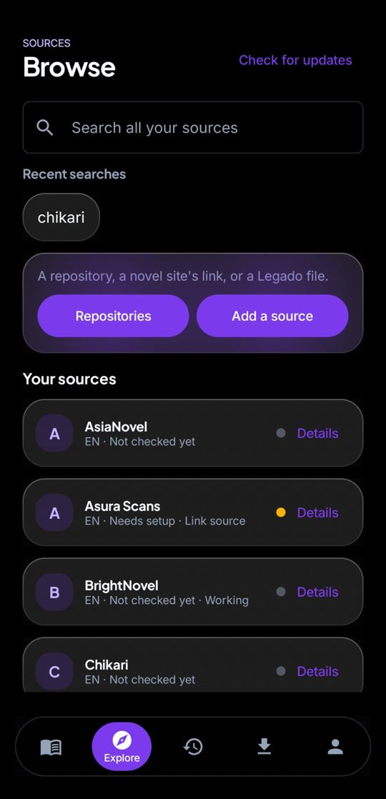
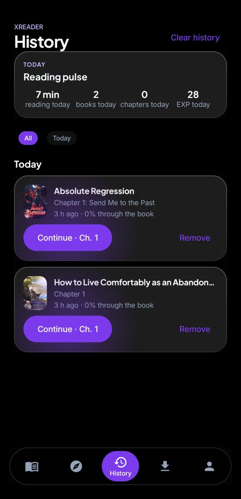
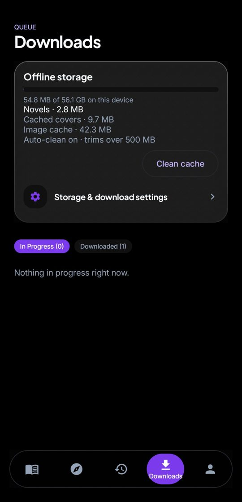
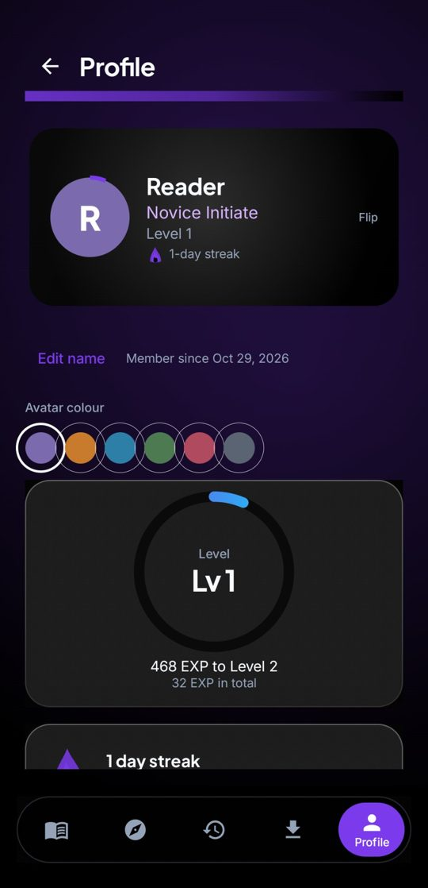

# Xreader

**A beautiful reader for novels and manga** — pure-black AMOLED design, real frosted glass, and a source engine that learns new sites on its own.

> **Where things stand:** novels are fully supported today. Manga — Keiyoushi sources and a dedicated image reader — is in development for the next major update; until it lands, manga sources added to the app will honestly say they need the manga update rather than pretend to work.

## Download

Get the latest APK from the [**Releases**](https://github.com/Hyperjoker2511/Xreader/releases) page. Enable "install from this source" for your browser or file manager when Android asks, then open the file. Upgrades keep your library, progress, downloads and settings — the signing key never changes.

## What it does

- **30 built-in sources**, each verified end to end (catalogue, search, book, chapter list, chapter text) before it ships — Korean, Chinese and Japanese novels in translation, plus English originals.
- **Add any site by pasting its link.** Xreader studies the site and learns how to read it — catalogue, books, chapters and search — always in the app's own native screens, never a bare web page. Sites that need a sign-in show their own login page once; the app securely reuses that session afterwards.
- **Repositories** — add source repositories (Novel Sourcery, LNReader and more) and browse their full catalogues per repo, with search and language filters.
- **A reader built for long novels** — progressive chapter loading (a book opens after the first chapters, the rest load as you read), true chapter numbers everywhere, custom fonts and paragraph spacing, themes, text-to-speech, and offline downloads with resume.
- **AI features with your own provider** — summaries, catch-up and lore with Gemini or compatible providers, plus offline translation. Your keys stay encrypted on your device.
- **Sign-in, handled honestly** — some sites keep chapters behind a second, short-lived key their own reader renews quietly; Xreader renews it the same way. When a site is down, rate-limiting, or unreachable, the app says exactly that — never a fake "empty" and never scrambled text dressed up as a chapter.

## Screenshots

  
  
  

  
  
  

## Design

**Nocturne Violet** — a pure-black `#000000` canvas built for AMOLED screens, electric violet accents, a floating glass dock with real backdrop blur, and one calm rule everywhere: *easy to understand, beautiful to see.* Deep customisation lives in one dedicated space; the defaults are designed to need none.

## Privacy

No accounts, no tracking, no analytics. Your library, progress and reading live on your device. Website sessions are stored encrypted (Android Keystore) and are never your passwords — signing out of a source wipes them.

## Contributing

Issues and pull requests are welcome — every contribution is reviewed and must pass the full test gate before merging. Please use the issue templates for bug reports and source problems.

## Licence

[MIT](LICENSE) © Hyperjoker2511
