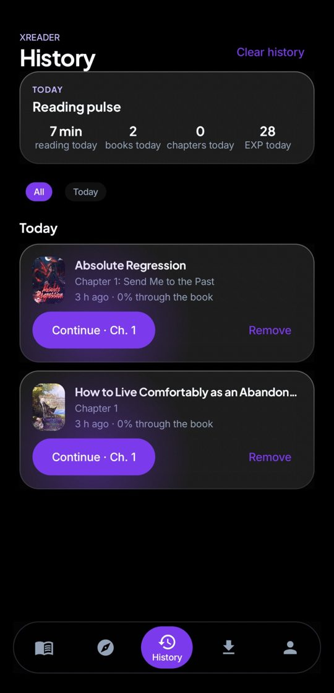
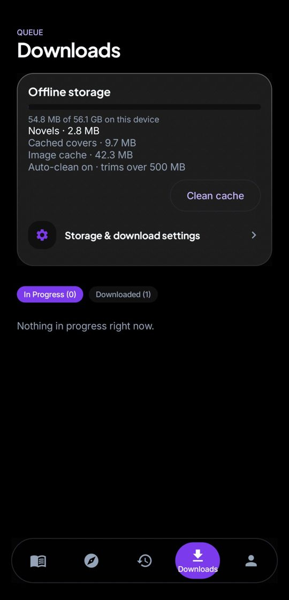
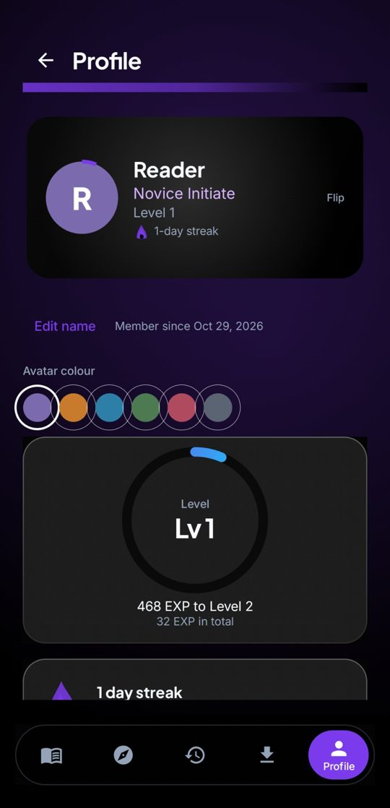

  

<h1 align="center">Xreader</h1>

<strong>A beautiful reader for novels and manga</strong> — pure-black AMOLED design, real frosted glass, and a source engine that learns new sites on its own.

> **Where things stand: this is our stable version** — fully tested and ready for everyone. Novels and manga are both fully supported. Novels read through built-in sources, provider packs and any site you add by link; manga reads through extension repositories in a dedicated image reader with tap zones, reading modes and border cropping.

## Download

Get the latest APK from the [**Releases**](https://github.com/Hyperjoker2511/Xreader/releases) page. Enable "install from this source" for your browser or file manager when Android asks, then open the file. Upgrades keep your library, progress, downloads and settings — the signing key never changes.

## What it does

- **36 built-in novel sources**, each verified end to end (catalogue, search, book, chapter list, chapter text) before it ships — Korean, Chinese and Japanese novels in translation, plus English originals.
- **Add any site by pasting its link.** Xreader studies the site and learns how to read it — catalogue, books, chapters and search — always in the app's own native screens, never a bare web page. Sites that need a sign-in show their own login page once; the app securely reuses that session afterwards.
- **Repositories** — add source repositories and browse their full catalogues per repo, with search and language filters.
- **Manga, properly** — 1,400+ manga sources through extension repositories, in a dedicated reader with smooth zoom, tap zones and reading modes. They live in Explore under **Manga sources** — the app checks for source updates itself and tells you when one is ready.
- **Your own books** — open EPUB and PDF files from your device and read them in the same calm reader, exactly as published.
- **A reader built for long novels** — progressive chapter loading (a book opens after the first chapters, the rest load as you read), true chapter numbers everywhere, custom fonts and paragraph spacing, themes, text-to-speech, and offline downloads with resume.
- **AI features with your own provider** — summaries, catch-up and lore with Gemini or compatible providers, plus offline translation. Your keys stay encrypted on your device.
- **Sign-in, handled honestly** — some sites keep chapters behind a second, short-lived key their own reader renews quietly; Xreader renews it the same way. When a site is down, rate-limiting, or unreachable, the app says exactly that — never a fake "empty" and never scrambled text dressed up as a chapter.

## Screenshots

  

  
  
  

## Design

**Nocturne Violet** — a pure-black `#000000` canvas built for AMOLED screens, electric violet accents, a floating glass dock with real backdrop blur, and one calm rule everywhere: *easy to understand, beautiful to see.* Deep customisation lives in one dedicated space; the defaults are designed to need none.

## Privacy

No accounts, no tracking, no analytics. Your library, progress and reading live on your device. Website sessions are stored encrypted (Android Keystore) and are never your passwords — signing out of a source wipes them.

## Contributing

Issues and pull requests are welcome — every contribution is reviewed and must pass the full test gate before merging. Please use the issue templates for bug reports and source problems.

## Legal notice

Xreader does not host, upload or store any books or other content, and it is not affiliated with any content provider. Everything you read through the app comes from the internet — publicly accessible third-party websites — or from files you open from your own device. Xreader only displays that content in a clean reader, much like a web browser or a search engine, and has no control over what those sites publish or remove.

All content belongs to its respective owners. Any copyright or legal questions about content should go to the sites and providers that host it — and please support the official releases and the authors. Xreader is for personal use; what you read with it is your responsibility under the laws where you live.

## Licence

[MIT](LICENSE) © Hyperjoker2511
