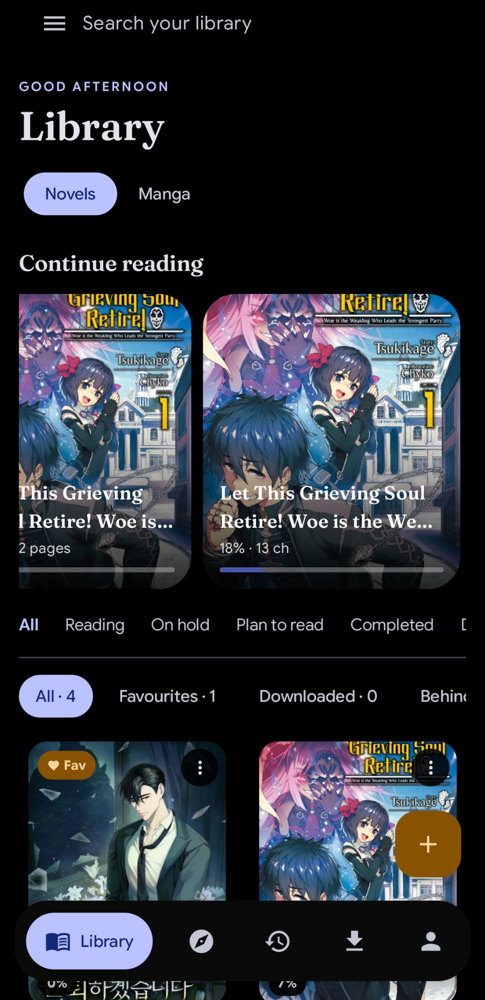
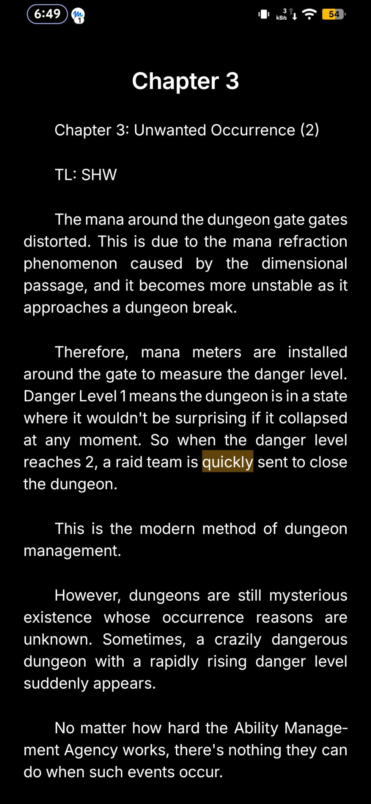
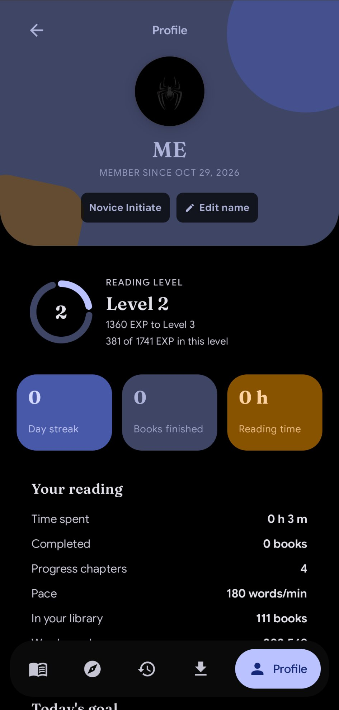

  

<h1 align="center">Xreader</h1>

<strong>One reader for novels, manga and your own books</strong> — two designs (Material 3 and Nocturne), sources that learn new sites on their own, and your library kept exactly the way you like it.

> **Where things stand: v1.7.0 is the current release** — fully tested and ready for everyone. Novels and manga are both fully supported. Novels read through built-in sources, provider packs and any site you add by link; manga reads through extension repositories in a dedicated image reader with tap zones, reading modes and border cropping. Your own book files read in the same app, in the same library.

## Download

Get **v1.7.0** from the [**Releases**](https://github.com/Hyperjoker2511/Xreader/releases) page — or let the app update itself: Xreader checks for new versions and offers them in-app. Enable "install from this source" for your browser or file manager when Android asks, then open the file. Upgrades keep your library, progress, downloads and settings — the signing key never changes.

## What it does

- **Built-in novel sources**, each verified end to end (catalogue, search, book, chapter list, chapter text) before it ships — Korean, Chinese and Japanese novels in translation, plus English originals.
- **Add any site by pasting its link.** Xreader studies the site and learns how to read it — catalogue, books, chapters and search — always in the app's own native screens, never a bare web page. Sites that need a sign-in show their own login page once; the app securely reuses that session afterwards.
- **Repositories** — add source repositories and browse their full catalogues per repo, with search and language filters.
- **Manga, properly** — a huge catalogue of manga sources through extension repositories, in a dedicated reader with smooth zoom, tap zones and reading modes. They live in Explore under **Manga sources** — the app checks for source updates itself and tells you when one is ready.
- **Your own books** — EPUB, PDF, DOCX, TXT, MOBI, FB2, CBZ and more, opened from your device and read in the same calm reader, with each book's own table of contents, highlights and notes. TXT books get proper chapter detection and encodings read for you (GBK, Big5, Russian and more).
- **A library with five statuses** — Reading · On hold · Plan to read · Completed · Dropped — plus favourites, history with your real reading numbers, and a profile with levels and streaks.
- **A reader built for long novels** — progressive chapter loading (a book opens after the first chapters, the rest load as you read), true chapter numbers everywhere, custom fonts and paragraph spacing, themes, and offline downloads with resume.
- **Read aloud** — your device's voice, or an online voice when you want a better one; it speaks the book's original text and keeps going chapter after chapter.
- **Ask AI, on its own page** — summaries, catch-up, translation, illustrations and a lore chat that remembers your book, with your own provider (Gemini or compatible). Your keys stay encrypted on your device.
- **Backup & sync** — keep your library safe in a backup file, on Google Drive, or on your own WebDAV server.
- **Sign-in, handled honestly** — some sites keep chapters behind a second, short-lived key their own reader renews quietly; Xreader renews it the same way. When a source fails, the app names the source and the reason — didn't answer, couldn't be read, couldn't be reached — with Retry beside it. Never a fake "empty" and never scrambled text dressed up as a chapter.

## Screenshots

  

  
  

## Design

Two complete designs, one app — every feature exists in both; only the look changes.

**Material 3** — the default for new installs. Google's Material 3 Expressive, coloured from your phone's own palette or any colour you pick.

**Nocturne** — a pure-black `#000000` canvas built for AMOLED screens, violet accents, and a floating glass dock with real backdrop blur.

An update never switches your design — what you chose stays chosen. Deep customisation lives in one dedicated space, Customise; the defaults are designed to need none. One calm rule everywhere: *easy to understand, beautiful to see.*

## Privacy

No accounts, no tracking, no analytics. Your library, progress and reading live on your device. Website sessions are stored encrypted (Android Keystore) and are never your passwords — signing out of a source wipes them.

## Contributing

Issues and pull requests are welcome — every contribution is reviewed and must pass the full test gate before merging. Please use the issue templates for bug reports and source problems.

## Legal notice

Xreader does not host, upload or store any books or other content, and it is not affiliated with any content provider. Everything you read through the app comes from the internet — publicly accessible third-party websites — or from files you open from your own device. Xreader only displays that content in a clean reader, much like a web browser or a search engine, and has no control over what those sites publish or remove.

All content belongs to its respective owners. Any copyright or legal questions about content should go to the sites and providers that host it — and please support the official releases and the authors. Xreader is for personal use; what you read with it is your responsibility under the laws where you live.

## Licence

[MIT](LICENSE) © Hyperjoker2511
